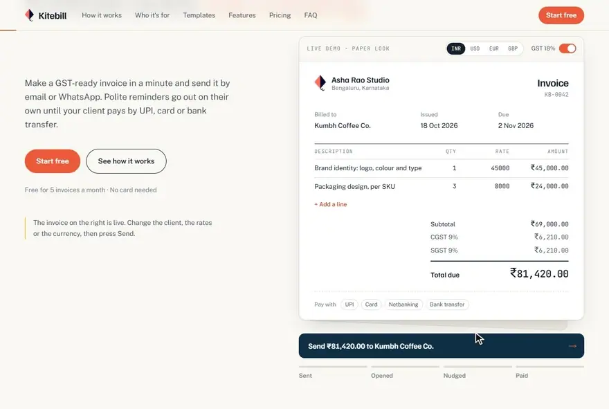
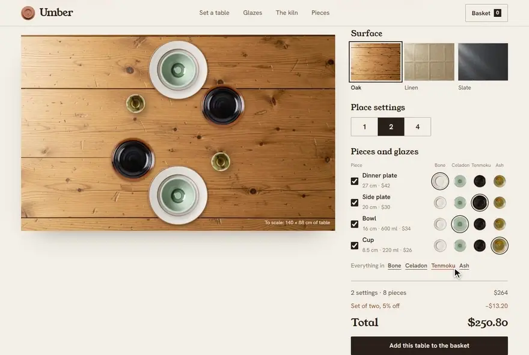
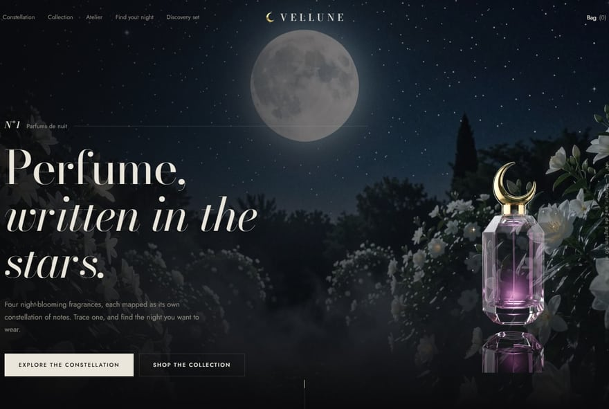
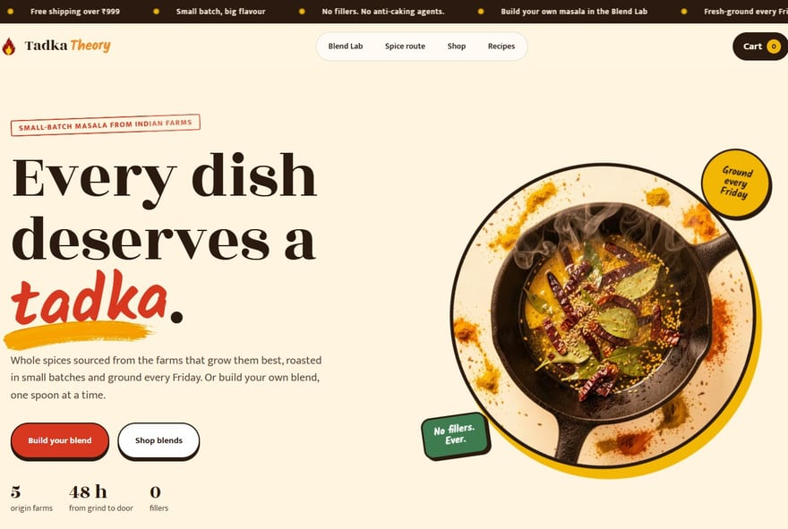
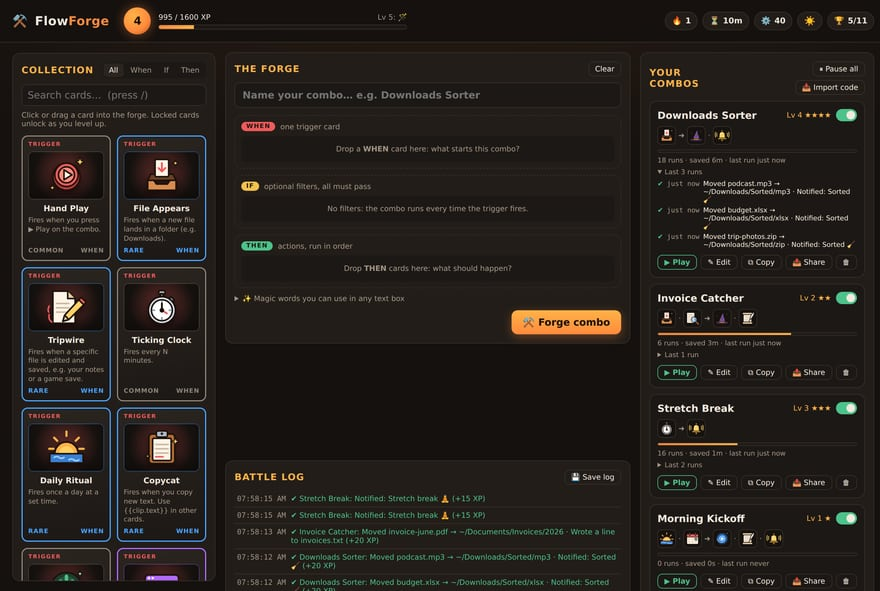

# Vaibhav Shukla

**Shopify and frontend developer.** I design and build storefronts and landing pages that load fast and are a pleasure to use: Shopify themes and custom Liquid sections, Next.js and React sites, and Figma designs turned into responsive code.

[Hire me on Upwork](https://www.upwork.com/freelancers/~01e34c5fa04da53175) · [Fiverr](https://www.fiverr.com/vaibhavshukl11) · [Email](mailto:vaibhavshukl23@gmail.com) · [LinkedIn](https://linkedin.com/in/vaibhav-shukla)

<br>

<a href="https://kitebill-app.pages.dev"></a>

**[Kitebill](https://kitebill-app.pages.dev)**: a landing page for a concept invoicing app, where the hero is a working invoice. Change the lines, the currency or the GST and press Send to watch it get opened, nudged and paid. Next.js, React and Tailwind CSS, with a scroll story and a template carousel further down. [Source](https://github.com/Necromancervbh/kitebill)

## Selected work

<table>
  <tr>
    <td width="50%" valign="top">
      <a href="https://umber-studio.pages.dev"></a>
      <br><b><a href="https://umber-studio.pages.dev">Umber</a></b>
      <br>Stoneware store with a set-the-table builder: plates, bowls and cups laid out to scale on real table photos, in any glaze.
    </td>
    <td width="50%" valign="top">
      <a href="https://vellune-parfums.pages.dev"></a>
      <br><b><a href="https://vellune-parfums.pages.dev">Vellune</a></b>
      <br>Perfume house with a scent constellation: pick a fragrance and its top, heart and base notes draw themselves as stars.
    </td>
  </tr>
  <tr>
    <td width="50%" valign="top">
      <a href="https://tadka-theory.pages.dev"></a>
      <br><b><a href="https://tadka-theory.pages.dev">Tadka Theory</a></b>
      <br>Indian spice store with a Blend Lab: spoon spices into a jar, watch the flavour chart reshape and get a named blend.
    </td>
    <td width="50%" valign="top">
      <a href="https://necromancervbh.github.io/Flowforge-/"></a>
      <br><b><a href="https://github.com/Necromancervbh/Flowforge-">FlowForge</a></b>
      <br>A deckbuilder where every card is a real PC automation. Snap WHEN, IF and THEN cards into combos that sort files and watch pages.
    </td>
  </tr>
</table>

<sub>Kitebill, Umber, Vellune and Tadka Theory are concept sites I designed and built end to end. Their photography is AI-generated.</sub>

## Open source

**[shopify-speed-audit](https://github.com/Necromancervbh/shopify-speed-audit)** checks a Shopify store for the usual speed problems and tells you what to fix first. No install, no dependencies:

```text
$ npx github:Necromancervbh/shopify-speed-audit theme-dawn-demo.myshopify.com

Shopify speed audit  https://theme-dawn-demo.myshopify.com/
  Theme: Dawn (Dawn 15.0.0)
  Score 99/100 (A)

  ! Embedded iframes  1 load immediately
  ✓ Render-blocking scripts  0 in <head> without async or defer
  ✓ Hero image loading  first images load eagerly
```

- **[slack-doc-bot](https://github.com/Necromancervbh/slack-doc-bot)**: answers team questions in Slack from internal documents, using retrieval with LangChain, Pinecone and GPT-4o.
- **[consultbae-ai-automation](https://github.com/Necromancervbh/consultbae-ai-automation)**: merges candidate data from three recruitment sources, deduplicates it and tags skills with an LLM through n8n, plus an audio collection app with signal analysis.
- **[FlowForge](https://github.com/Necromancervbh/Flowforge-)**: the automation deckbuilder above. Zero dependencies, tested on Windows, macOS and Linux. [Play it in the browser](https://necromancervbh.github.io/Flowforge-/).

## Before freelancing

I studied Computer Science with a Data Science specialisation at UPES and worked as a Data Science intern at IBM, building end-to-end machine learning pipelines. Projects from that time:

- **TaxConnect**: a two-sided Android marketplace that connects taxpayers with chartered accountants, with in-app WebRTC video consultations. Kotlin, MVVM, Firebase.
- **Patient outcome predictor**: a reproducible pipeline on clinical data, above 85% accuracy, using SMOTE for the class imbalance.
- **Customer churn predictor**: a classifier trained on 10,000 telecom records, 0.91 AUC-ROC.

## Tools

Shopify and Liquid · Next.js · React · TypeScript · JavaScript · Tailwind CSS · HTML and CSS · Figma · Node.js · Python · Kotlin · Git

<br>

**Open to freelance work:** Shopify builds and fixes, landing pages, and Figma to code. [Upwork](https://www.upwork.com/freelancers/~01e34c5fa04da53175) · [Fiverr](https://www.fiverr.com/vaibhavshukl11) · [vaibhavshukl23@gmail.com](mailto:vaibhavshukl23@gmail.com)
